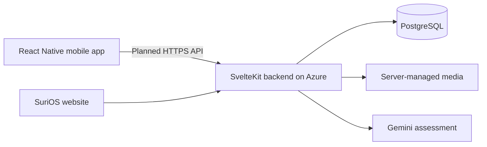

# SuriOS — Mobile Infrastructure Reporting

**UN SDG 9: Industry, Innovation and Infrastructure**
*A dedicated React Native companion to the SuriOS community infrastructure platform.*

---

## 1. Overview

**SuriOS** takes its name from the Tagalog word *suri*: to inspect and analyze. The platform helps communities document public infrastructure defects and follow accountable government responses, starting in Santa Cruz, Laguna.

This repository contains the **mobile client**, built with **React Native, Expo, Expo Router and TypeScript**. The [SuriOS web repository](https://github.com/Auvryy/surios-ai) remains responsible for the SvelteKit website, Azure backend, PostgreSQL database and server-side Gemini assessment.

### Current status

This is an initialized mobile foundation, **not yet a connected reporting app**.

- Working home and About screens with SuriOS orange branding.
- System light/dark appearance, safe-area layout and responsive browser preview.
- File-based navigation and a missing-page screen.
- Strict TypeScript, linting, reproducible npm lockfile and web/Android bundle commands.
- Optional public API-origin configuration, ready for the integration phase.

**Not implemented yet:** sign-in, account persistence, live feed, uploads, camera/GPS, hazard map, report assessment, reactions, comments and government-resolution links. No demo posts or fabricated AI assessments are presented as live data. Launcher icons are Expo template placeholders pending final SuriOS artwork.

### Planned reporting scope

Road pavement; bridges and footbridges; drainage and flood canals; streetlights and utility poles; water pipes and hydrants; telecom and fiber cables. Reporting is broader than roads. AI should distinguish visible evidence from reporter claims and support qualified human inspection rather than replace it.

## 2. Documentation index

| Document | Purpose |
| :--- | :--- |
| [Development guide](docs/DEVELOPMENT.md) | Arch Linux setup, browser and phone testing, environment variables and checks |
| [Architecture](docs/ARCHITECTURE.md) | Mobile/web/backend responsibilities, data flow and security boundaries |
| [Roadmap](docs/ROADMAP.md) | Ordered implementation phases and acceptance criteria |
| [Agent quick reference](AGENTS.md) | Seven operating rules, workspace isolation and manual push workflow |
| [Engineering constitution](GEMINI.md) | Full mobile stack, code, security, UI, assessment and Git instructions |

## 3. Quickstart — lightweight browser development

Use **Node.js LTS** (Node 24 recommended; see `.nvmrc`), npm, Git and your existing browser. Android Studio, an emulator, a JDK and global Expo CLI installation are **not required for browser preview**.

```bash
npm ci
npm run web
```

Open the URL printed by Expo, normally **http://localhost:8081**. Use browser responsive mode for a phone-sized viewport. This previews React Native Web; native camera, GPS and permission behavior still needs a phone or emulator.

For the first clone:

```bash
git clone git@github.com:Auvryy/surios-ai-app.git
cd surios-ai-app
```

### Android phone preview

Install Expo Go on your phone, connect it to the same network as your PC, then:

```bash
npm start
```

Scan the QR code. Your installed Expo Go must support this project's Expo SDK (see `package.json`). If versions differ, use a compatible Expo Go version or a development build. Native dependencies outside Expo Go require a development build.

Optional phone mirroring on Arch Linux:

```bash
sudo pacman -S --needed scrcpy android-tools
```

Enable USB debugging, connect and authorize your phone, then run `scrcpy`. These packages can be installed later; they are unnecessary for browser work.

## 4. Technology stack

| Technology | Purpose | Why it fits |
| :--- | :--- | :--- |
| React Native | Dedicated Android/iOS interface | Native interface components with shared mobile code |
| Expo | Development server, device tooling and future builds | Lightweight browser/phone workflow; cloud builds available later |
| Expo Router | File-based navigation and deep-link foundation | Keeps routes explicit across mobile and web preview |
| TypeScript | Static type checking | Makes screen and future API contracts easier to maintain |
| React Native Web | Browser development preview | Enables layout iteration without an Android emulator |
| React Native StyleSheet | Layout and semantic theme tokens | Minimal styling dependencies and consistent orange branding |
| Existing SvelteKit backend on Azure | Future authenticated API access | Reuses business rules and the existing deployment |
| Existing PostgreSQL + Drizzle | Shared persistence through the backend | One authoritative dataset for web and mobile |
| Existing server-side Gemini integration | Future evidence-grounded assessment | AI credentials and assessment rules stay on the server |

The final three rows describe the existing platform and **planned mobile integration**; this starter does not connect to those services yet. Mobile navigation components are separate from the website's Svelte components.

## 5. Configuration and security

The starter runs without an environment file. When integration begins, copy `.env.example` to `.env` and set:

```dotenv
EXPO_PUBLIC_API_BASE_URL=https://your-surios-domain.example
```

This is a placeholder, not a deployed endpoint. `EXPO_PUBLIC_` values are public and bundled into the client. Never include Gemini keys, database URLs, passwords or session secrets. The app will talk to the backend over HTTPS, never directly to PostgreSQL or Gemini.

A phone's `localhost` points to the phone, not your development PC. See the development guide before connecting to a local backend. Mobile authentication and cross-origin browser access still require backend work.

## 6. Validation

```bash
npm run check
npm run export:web
npm run export:android
npx expo-doctor
```

Android export verifies the JavaScript bundle; it does **not** produce an APK or prove native-device behavior. Native builds, signing, store submission and EAS project setup are not configured yet.

## 7. Repository layout

```text
src/
  app/                 Expo Router screens and root layout
  components/          Shared React Native UI
  config/              Public environment configuration
  constants/           Orange light/dark theme tokens
assets/                Template launcher assets; branding replacement pending
docs/                  Development, architecture and roadmap
```

## 8. SDG 9 connection

The intended mobile workflow makes it easier to document defects in the field, locate affected assets and follow repair evidence. This supports resilient infrastructure under SDG 9. Telecom/fiber reporting also relates to target 9.c. The platform does not claim that reporting alone proves improved infrastructure outcomes; deployment should measure response times, verified repairs and report quality.

## 9. Architecture at a glance

The mobile app is a separate client of the existing Azure system. It shares backend records and rules with the website; it does not run SvelteKit, PostgreSQL or Gemini inside the phone.



Only the local mobile screens exist in this repository today. Read the [architecture guide](docs/ARCHITECTURE.md) for component responsibilities, request sequences, data ownership, security and deployment boundaries.

## 10. Contributor workflow

Read [AGENTS.md](AGENTS.md) and [GEMINI.md](GEMINI.md) before editing. Start genuinely new features on a descriptive branch from verified current main, and stay on the agreed branch for follow-up fixes. Do not switch branches at the end of a prompt. Preserve orange branding and keep secrets on the backend. Do not push or deploy without explicit instructions. Mobile uses React hooks/native components; the website's Svelte-specific syntax rules do not apply here.

## 11. Next steps

Start with authenticated citizen access and a real feed from the existing backend. Add photo capture, location selection and server-side assessment next, then shared-hazard resolution links and interactions. Keep government administration on the website initially. See the [roadmap](docs/ROADMAP.md) for dependencies and completion criteria.

The initial Expo toolchain has unresolved npm audit findings; see the [dependency audit note](docs/DEVELOPMENT.md#initial-dependency-audit). This foundation is for development and is not a release-ready APK.
