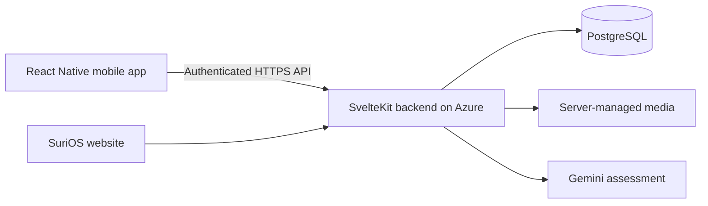

# SuriOS — Mobile Infrastructure Reporting

**UN SDG 9: Industry, Innovation and Infrastructure**
*A dedicated React Native companion to the SuriOS community infrastructure platform.*

---

## 1. Overview

**SuriOS** takes its name from the Tagalog word *suri*: to inspect and analyze. The platform helps communities document public infrastructure defects and follow accountable government responses, starting in Santa Cruz, Laguna.

This repository contains the **mobile client**, built with **React Native, Expo, Expo Router and TypeScript**. The [SuriOS web repository](https://github.com/Auvryy/surios-ai) remains responsible for the SvelteKit website, Azure backend, PostgreSQL database and server-side Gemini assessment.

### Current status

The mobile client connects **accounts, the saved community feed, the hazard map and field reporting** to the existing SuriOS backend.

- Three first-run introduction slides, persistent completion, and registration/sign-in interface with SuriOS orange branding.
- Citizen feed (`/home` and `/citizen`) and About (`/about`) screens are available.
- Orange light-only appearance regardless of the device theme, safe-area layout and responsive browser preview.
- Citizen feed with bottom navigation, a center camera/post action, live street map, evidence previews and the connected report composer. Notifications remain a preview.
- File-based navigation and a missing-page screen.
- Strict TypeScript, linting, reproducible npm lockfile and web/Android bundle commands.
- Public API-origin configuration for the existing Azure backend.
- Real citizen registration and sign-in with the same accounts as the website; government/admin accounts can sign in, with pending/rejected applications held at their approval screen.
- Native session tokens in Expo SecureStore, browser-preview tokens in tab-scoped sessionStorage, server-validated restoration, expiry handling and logout.
- Saved citizen posts and official updates, photo previews, cumulative pagination and refresh/retry.
- In-app post details and official updates with full evidence, current hazard status, comments/replies, post/comment likes, social reposts with optional images, and device sharing. Feed and profile posts open the same saved discussions as the website.
- Profile tab and protected `/profile` route with the website's cover/avatar layout, saved personal post history, editable name and photos, and office details/statistics for government accounts. Changes use the existing Azure profile API and refresh the shared account identity.
- Settings from the profile gear or protected `/settings` route: saved email notification preferences, password changes and reset-link requests through the existing Azure endpoints. Delivery availability and failures are shown honestly; mobile remains light-only.

**First run:** intro completion is stored locally on the device. New users see three introduction slides; the last step and Skip open registration. A valid restored session opens the citizen feed. Otherwise returning users see sign-in. Successful citizen registration creates an active account without requiring email delivery.

**Reporting:** camera/library evidence, photos/videos and cover selection, foreground GPS/manual pins, mapped road sections, server AI assessment, draft cancellation and real publishing. The map includes filters, clustering, road lines, source/evidence links and official resolution links.

**Still planned:** notifications and distribution configuration. Discussions use the existing backend, with persistence verified against a disposable local instance. Launcher icons remain Expo placeholders. Azure bearer API and browser login/session/feed/logout were verified at `https://surios.site`; localhost browser origins are now allowlisted. Real-device authentication/storage execution still requires device validation; browser tests and bundle exports do not prove it.

### Reporting scope

Road pavement; bridges and footbridges; drainage and flood canals; streetlights and utility poles; water pipes and hydrants; telecom and fiber cables. Reporting is broader than roads. AI should distinguish visible evidence from reporter claims and support qualified human inspection rather than replace it.

## 2. Documentation index

| Document | Purpose |
| :--- | :--- |
| [Development guide](docs/DEVELOPMENT.md) | Arch Linux setup, browser and phone testing, environment variables and checks |
| [Architecture](docs/ARCHITECTURE.md) | Mobile/web/backend responsibilities, data flow and security boundaries |
| [Roadmap](docs/ROADMAP.md) | Ordered implementation phases and acceptance criteria |
| [Map and reporting](docs/REPORTING.md) | Field workflow, map controls, permissions, draft lifecycle and verification |
| [Authentication](docs/AUTHENTICATION.md) | Shared account flow, session storage, Azure/local setup, failures and tests |
| [Profiles](docs/PROFILE.md) | Website-matched profile design, photo/name editing, office details, Azure contracts and verification |
| [Post details and discussions](docs/DISCUSSIONS.md) | Native threads, official evidence, comments/replies, reactions, reposts, sharing and verification |
| [Settings](docs/SETTINGS.md) | Email preferences, password changes, recovery email, security boundaries and verification |
| [Agent quick reference](AGENTS.md) | Seven operating rules, workspace isolation and user-managed branch workflow |
| [Engineering constitution](GEMINI.md) | Full mobile stack, code, security, UI, assessment and Git instructions |

## 3. Quickstart — lightweight browser development

Use **Node.js LTS** (Node 24 recommended; see `.nvmrc`), npm, Git and your existing browser. Android Studio, an emulator, a JDK and global Expo CLI installation are **not required for browser preview**.

```bash
npm ci
cp .env.example .env
npm run web
```

Open the URL printed by Expo, normally **http://localhost:8081**. Use browser responsive mode for a phone-sized viewport. This previews React Native Web; native camera, GPS and permission behavior still needs a phone or emulator.

The template targets the existing Azure backend at **https://surios.site**. Its browser allowlist includes `http://localhost:8081` and `http://127.0.0.1:8081`. Sign in with your website account to open **http://localhost:8081/citizen**; direct signed-out visits are protected. A separate local backend is optional. See the [authentication setup](docs/AUTHENTICATION.md).

For the first clone:

```bash
git clone git@github.com:Auvryy/surios-ai-app.git
cd surios-ai-app
```

### Android phone preview

Install Expo Go on your phone, connect it to the same network as your PC, then:

```bash
npm start
```

Scan the QR code. Your installed Expo Go must support this project's Expo SDK (see `package.json`). If versions differ, use a compatible Expo Go version or a development build. Native dependencies outside Expo Go require a development build.

Optional phone mirroring on Arch Linux:

```bash
sudo pacman -S --needed scrcpy android-tools
```

Enable USB debugging, connect and authorize your phone, then run `scrcpy`. These packages can be installed later; they are unnecessary for browser work.

## 4. Technology stack

| Technology | Purpose | Why it fits |
| :--- | :--- | :--- |
| React Native | Dedicated Android/iOS interface | Native interface components with shared mobile code |
| Expo | Development server, device tooling and future builds | Lightweight browser/phone workflow; cloud builds available later |
| Expo Router | File-based navigation and deep-link foundation | Keeps routes explicit across mobile and web preview |
| TypeScript | Static type checking | Makes screen and future API contracts easier to maintain |
| React Native Web | Browser development preview | Enables layout iteration without an Android emulator |
| React Native StyleSheet | Layout and semantic theme tokens | Minimal styling dependencies and consistent orange branding |
| Leaflet + native WebView | Same OpenStreetMap street rendering as the website | Bundled map renderer, no map API key; forms and controls remain native |
| Expo ImagePicker / Location / Video | Camera/library evidence, foreground GPS and playback | SDK-compatible device adapters with manual location alternatives |
| Expo SecureStore | Persistent native session credential storage | Uses the platform's encrypted storage; tokens are not stored in AsyncStorage |
| Existing SvelteKit backend on Azure | Authenticated JSON API access | Reuses business rules and the existing deployment |
| Existing PostgreSQL + Drizzle | Shared persistence through the backend | One authoritative dataset for web and mobile |
| Existing server-side Gemini integration | Evidence-grounded assessment | AI credentials and assessment rules stay on the server |

The app calls the existing account, feed, map, road and assessment/publication APIs. PostgreSQL and Gemini remain behind that backend. Mobile navigation components are separate from the website's Svelte components.

## 5. Configuration and security

Copy `.env.example` to ignored `.env` and set the public origin of the **same website server**, without `/api`:

```dotenv
EXPO_PUBLIC_API_BASE_URL=https://surios.site
```

This is the verified shared Azure backend. No additional server/IP/database is required. `EXPO_PUBLIC_` values are public and bundled into the client. Never include Gemini keys, database URLs, passwords or session secrets. Release builds require HTTPS. Restart Expo after changing the origin. An ignored `.env.local` overrides `.env` for local development; keep the intended origin consistent between them.

A phone's `localhost` points to the phone, not your development PC. See the development guide before connecting to a local backend. Browser previews require the backend's exact `API_ALLOWED_ORIGINS` allowlist; native bearer requests need no synthetic Origin or browser cookie. The backend contract is [MOBILE_API.md in the web repository](https://github.com/Auvryy/surios-ai/blob/main/docs/MOBILE_API.md).

## 6. Validation

```bash
npm run check
npm run export:web
npm run export:android
npx expo-doctor
npm test
```

Android export verifies the JavaScript bundle; it does **not** produce an APK or prove native-device behavior. Native builds, signing, store submission and EAS project setup are not configured yet.

## 7. Repository layout

```text
src/
  app/                 Entry gate, onboarding, auth, citizen feed/Home, protected Profile/Settings and About routes
  components/          Shared React Native UI, citizen navigation, map controls and report composer
  config/              Public environment configuration
  auth/                Account contracts, session controller/provider and platform-specific token storage
  lib/                 JSON/multipart transport, feed/map contracts, road geometry and motion preference
  reporting/           Draft lifecycle, media picker/uploads and foreground GPS
  constants/           Orange theme and onboarding preference key
assets/                Bundled Leaflet/license, reference geometry and placeholder launcher artwork
docs/                  Development, architecture and roadmap
```

## 8. SDG 9 connection

The intended mobile workflow makes it easier to document defects in the field, locate affected assets and follow repair evidence. This supports resilient infrastructure under SDG 9. Telecom/fiber reporting also relates to target 9.c. The platform does not claim that reporting alone proves improved infrastructure outcomes; deployment should measure response times, verified repairs and report quality.

## 9. Architecture at a glance

The mobile app is a separate client of the existing system. Authentication, feed/map reads and report publishing share backend records and rules with the website; it does not run SvelteKit, PostgreSQL or Gemini inside the phone.



Read the [architecture guide](docs/ARCHITECTURE.md) for implemented client/backend responsibilities and reporting sequence. Azure readiness depends on deploying the merged backend and configuring the app's public origin.

## 10. Contributor workflow

Read [AGENTS.md](AGENTS.md) and [GEMINI.md](GEMINI.md) before editing. Start genuinely new features on a descriptive branch from verified current main, and stay on the agreed branch for follow-up fixes. Do not switch branches at the end of a prompt. Preserve orange branding and keep secrets on the backend. Do not push or deploy without explicit instructions. Mobile uses React hooks/native components; the website's Svelte-specific syntax rules do not apply here.

## 11. Next steps

Validate the camera, GPS, map gestures, session storage and upload recovery on your physical device. Browser reporting and a real local backend save/read flow are tested. In-app discussions, reactions and image reposts are implemented and verified against an isolated real backend; device sharing and native media still need phone acceptance. Government administration stays on the website initially. See the [roadmap](docs/ROADMAP.md).

The initial Expo toolchain has unresolved npm audit findings; see the [dependency audit note](docs/DEVELOPMENT.md#initial-dependency-audit). This foundation is for development and is not a release-ready APK.
