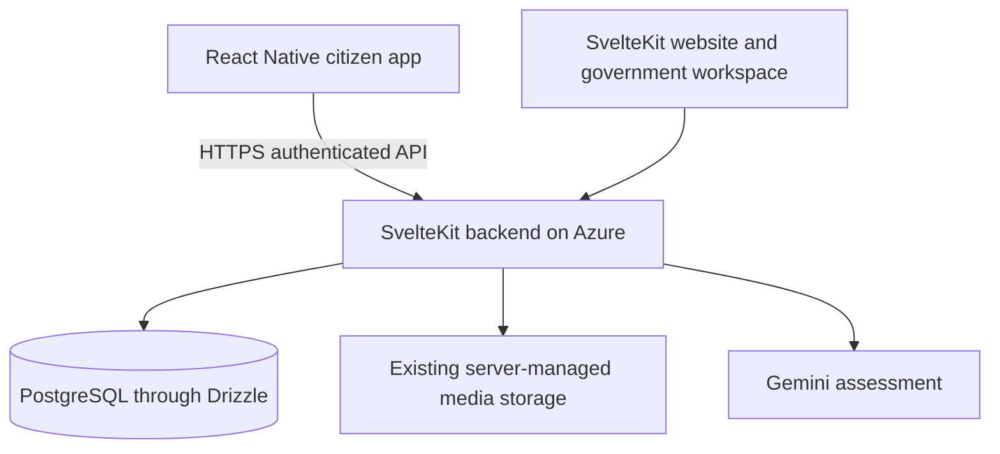

# Mobile system architecture

## Current implementation

The repository is an Expo-managed React Native client with a static browser preview. Home and About screens run locally; there are no backend requests, stored credentials, database connections or AI calls. Expo Router owns navigation. Shared semantic color tokens support system light/dark mode.

## Intended integrated architecture

The diagram describes the target integration, not services newly deployed by this repository.

| Layer | Responsibility |
| --- | --- |
| Screens | Navigation, input, accessible feedback, rendering API results |
| Native integrations, future | Camera/gallery permissions, GPS and device-specific behavior |
| Mobile API client, future | Validated requests, upload progress, errors and session handling |
| Azure backend | Authentication, authorization, input validation, assessment, grouping and resolution rules |
| PostgreSQL | Authoritative users, posts, hazards, linked reports and official updates |
| Media storage | Original uploads and government evidence; lifecycle controlled by backend |
| Gemini | Server-invoked analysis under the existing evidence-grounding rules |

## Reporting data flow, planned

1. Citizen authenticates against the backend. Mobile credential/session handling must be designed before live sign-in.
2. Citizen captures/selects media and identifies the issue location.
3. Mobile sends media and reporter context to authenticated backend assessment endpoints.
4. Backend validates media and permissions, calls Gemini and returns the saved assessment draft.
5. Citizen reviews the result and submits the report. Backend validates the draft and selected geometry and persists the post.
6. Web and mobile read the same saved report. Official progress/resolution updates remain authoritative backend records.
7. Resolving a hazard updates linked posts through existing server rules; mobile displays the official evidence link returned by the API.

Physical severity, community support and response priority remain separate concepts. Mobile must not replace server classification or grouping with client-side guesses. A selected road segment is location context and does not change the assessed infrastructure type.

## Integration work required

The existing SvelteKit website uses server-rendered loaders/actions and sessions. A native client cannot reuse Svelte page components or assume browser cookies work unchanged. Before connecting screens:

- Audit existing endpoints and expose suitable authenticated JSON contracts where needed.
- Choose a mobile session flow and secure credential storage; retain logout/revocation and role permissions.
- Define browser-preview CORS, cookie/CSRF behavior and trusted origins explicitly.
- Resolve relative media and post URLs against the configured backend origin.
- Preserve upload limits, draft ownership, error handling, pagination and server-side validation.
- Test account and media access using the same Azure environment as the website.

No second database, separate seeding process or duplicate Gemini integration is planned. No API domain has been assumed.

## Security and runtime boundaries

All EXPO_PUBLIC variables are public build configuration. Gemini keys, DB credentials and signing secrets never belong in those variables or source control. Future persisted mobile credentials should use platform-secure storage. A shared backend does not imply sharing a browser session automatically.

Camera/GPS require runtime consent and useful denial handling. Offline drafts, background sync and push notifications are future work, not existing guarantees. The default design requires network access for live reports and assessment.

Browser export verifies a web target. Android bundle export verifies JavaScript bundling. Neither proves native permissions, signing, installation or store acceptance. Those require a device build and explicit testing.
