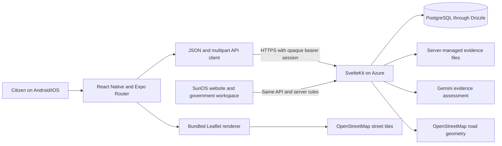
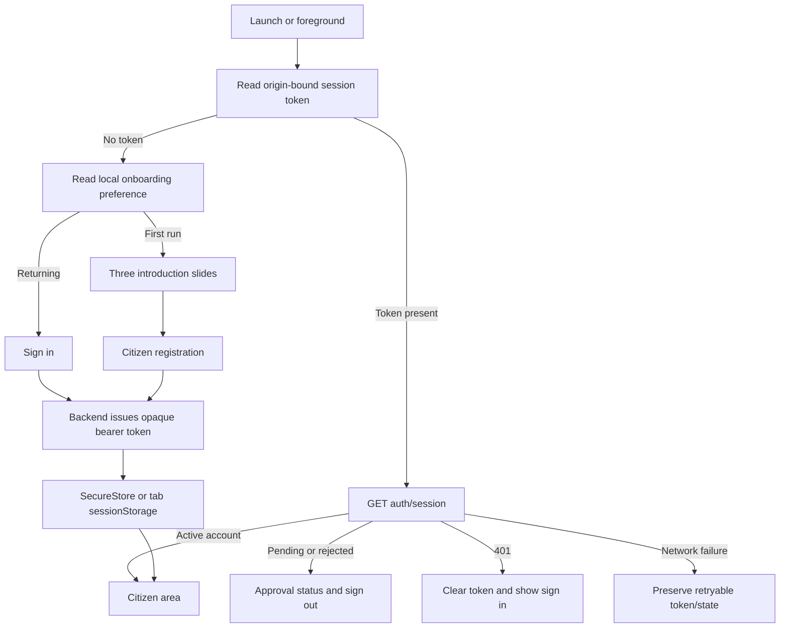
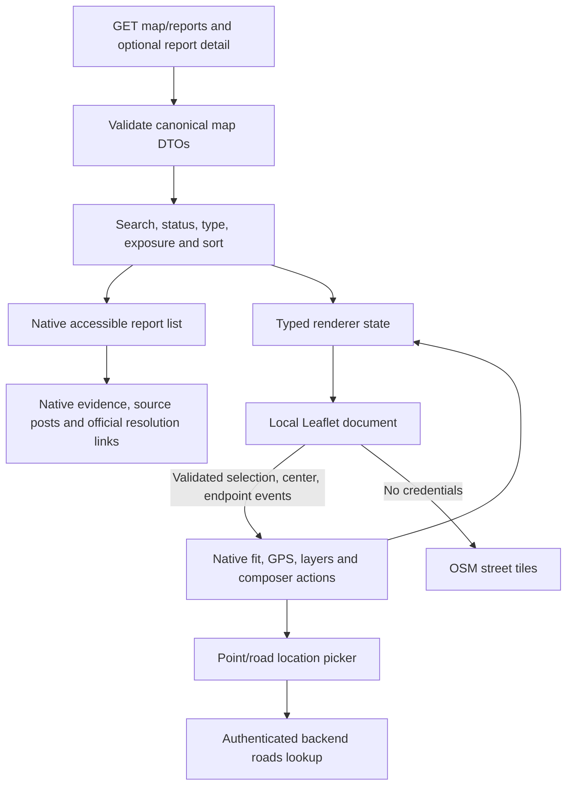

# Mobile system architecture

## Implemented system

SuriOS Mobile is an Expo-managed React Native client of the existing SvelteKit backend on Azure. The website and app share accounts, profiles, reports, uploaded evidence, canonical hazards and government updates in the existing PostgreSQL database. The app implements citizen signup/login, secure sessions, profile editing and personal post history, saved feed reads, a live hazard map, camera/library evidence selection, foreground GPS/manual locations, road sections, assessment drafts, publishing and native post/update discussions with reactions, replies, image reposts and sharing.

The app renders native forms, navigation, cards, buttons and sheets using React Native primitives and shared orange light-only tokens. Expo Router owns protected routes. Only the map canvas runs a bundled local Leaflet document inside a native WebView; browser preview uses a sandboxed iframe with the same document. There is no second backend/database or client-side Gemini integration.

## Client/server topology



Map tile requests go directly to OpenStreetMap without session headers. Road lookup and validation go through the backend. Authentication, permissions, assessment, grouping and resolution remain server-side.

| Layer | Technology/location | Purpose and boundary |
| --- | --- | --- |
| Routing and screens | Expo Router, `src/app` | Entry/onboarding, authentication, protected citizen area, Home alias, Profile, Settings, post/update details and About. Protected links retain their destination during session verification; screen gates hold private data until the account is active. No SQL or AI logic. |
| Presentation | React Native, `src/components` | Native feed, sheets, evidence/video preview, composer, map controls and bottom navigation; shadcn-like flat surfaces and borders. |
| Design tokens | `src/constants/theme.ts` | Orange, fixed light appearance, readable surface/text/error/success colors. Device dark mode does not change the theme. |
| Account/session | `src/auth` | Validated account contracts, restore/login/logout, approval handling, origin-bound credentials, expiry and race protection. |
| Native credential storage | Expo SecureStore | Stores the opaque session token; never passwords or full private account objects. |
| Browser credential storage | Platform `.web` adapter | Tab-scoped sessionStorage; not localStorage or AsyncStorage. |
| API transport | `src/lib/api-client.ts` | JSON/multipart, bearer headers, cancellation, bounded timeouts, origin/path checks and server error details. Multipart boundaries come from the transport. |
| Domain contracts | `src/lib/feed.ts`, `map-data.ts`, `report-contracts.ts` | Validate API data before rendering; preserve canonical status/severity and source/resolution links. |
| Own profile | `src/lib/profile.ts`, `profile-media.ts`, `src/components/profile` | Validate the signed-in account's profile, personal cumulative feed and office statistics; save public name, office fields and multipart photos through the existing API. Profile images are trusted public `/media` URLs. |
| Discussions | `src/lib/discussion.ts`, `repost-media.ts`, `share-post` adapters, `src/components/discussion` | Validate source/update threads, serialize writes, preserve reply drafts, use idempotent social reposts, render official evidence/history and share public links. |
| Settings | `src/lib/settings.ts`, `src/components/settings` | Load and save email preference booleans; change passwords and request recovery email with the existing bearer APIs. Validate confirmed responses, keep passwords only in memory and leave website appearance preferences unchanged. |
| Reporting lifecycle | `src/reporting/report-controller.ts` | In-memory form/draft state, evidence/context invalidation, cancellation/discard, cover mapping and idempotent publication. |
| Device evidence | Expo ImagePicker / FileSystem | System library and camera, file metadata and URI uploads. No base64 evidence copies in app state. |
| Device location | Expo Location | Foreground single location fix, permission/timeout handling and manual fallback. No background tracking. |
| Video | Expo Video | Selected and saved evidence playback; codec/device validation remains hardware-specific. |
| Road geometry | `src/lib/roads.ts` | Same website projection, interpolation and 5–500 m endpoint rules. Geometry locates an issue; it does not classify or group it. |
| Map rendering | Leaflet + native WebView / browser iframe | Local JS/CSS, OSM street tiles, pins, lines and gesture events; never receives bearer tokens. |
| Backend | Existing SvelteKit service | Authoritative validation, permissions, Gemini calls, issue identity/grouping, geometry verification and government resolution. |
| Persistence | Existing PostgreSQL + Drizzle and media storage | Shared records and evidence; clients access them through the API only. |

## Startup and account lifecycle



Successful citizen signup creates an active account without requiring email delivery. Existing government/admin accounts can sign in; pending/rejected applications cannot enter active features. Server role checks remain authoritative. Credentials are saved only after validated issuance; a storage failure revokes the new session. Logout revokes the server session and clears local storage. Cached active sessions stay visible during foreground revalidation, allowing camera/library return without discarding an open report.

Async requests use revision/cancellation guards so late login or restoration responses cannot resurrect a cancelled or revoked session. A 401 on a feature request invalidates the current credential. Offline restoration offers retry rather than treating an unverified stored token as authenticated.

## Assessment and publication sequence

```mermaid
sequenceDiagram
    actor Citizen
    participant UI as Native composer
    participant Draft as Report controller
    participant API as Existing SuriOS API
    participant AI as Server-side Gemini
    participant DB as PostgreSQL/media
    Citizen->>UI: Add headline, caption and evidence
    UI->>Draft: Validate selection and choose cover
    Citizen->>UI: Assess evidence
    Draft->>API: Multipart files/context + assessment UUID
    API->>AI: Grounded multi-asset assessment
    AI-->>API: Observations, severity and limitations
    API->>DB: Save owned assessment draft
    API-->>Draft: Draft ID, saved media, analysis and context
    Draft-->>UI: Show findings; retain editable form
    Citizen->>UI: Confirm point/road section and publish
    Draft->>API: Draft ID, cover ID, context and location
    API->>DB: Validate ownership/context/road; match or create hazard; save post
    API-->>Draft: Saved post ID, canonical report ID and grouped flag
    Draft-->>UI: Refresh feed and offer saved hazard
```

The backend alone decides whether media depicts supported infrastructure and what severity it warrants. Headline/caption are context, not proof. The app separates returned visible evidence from reporter claims and displays uncertainty/limitations. Selecting a road does not convert bridges, drainage, water or telecom reports into pavement reports. ASTM pavement terminology is not applied by the client to other assets.

Editing text or media invalidates the assessment. A client-generated UUID allows cancellation of the in-flight server job. Discard cleanup is serialized; late responses cannot restore stale evidence. Cover/location changes keep the assessment valid because the assessed evidence/context is unchanged. Draft ownership, 24-hour expiry, quota, file validation and final road verification remain backend checks.

Publishing disables repeat taps and editing. Uncertain failures keep the same draft for an idempotent retry. Missing/stale/expired drafts require reassessment. Successful publication transfers evidence ownership to the saved post; unmount cleanup never discards published media. Form contents are in memory while open: app termination, offline drafts and background synchronization are not implemented guarantees.

## Map architecture and lifecycle



The map polls saved reports every 30 seconds while active and refreshes on foreground. A failed refresh keeps the last loaded dataset and offers retry. Point pins and solid reported sections come from saved backend geometry. Optional dashed reference corridors copy website names/coordinates only, without fabricated condition scores. Pixel clustering exposes multiple separate hazards and does not change their identity.

The location picker uses actual OSM ways returned by `/api/roads`, selects within 40 metres and projects dragged or tapped endpoints along the way. Tap-to-move and ±5 m buttons make dragging optional. A landing shadow and reduced-motion-aware hop explain pin placement. GPS has a timeout and manual coordinate fallback. Backend verification prevents forged or stale road geometry from being trusted at publication.

Leaflet executable assets are bundled with their license; there is no remote script CDN. Native map navigation/file access is restricted, browser messages must come from the owned iframe, and event payloads are validated. All authentication and uploads remain outside the document. Street tiles and attribution are the only map-provider dependency; an internet connection is required.

Severity, support and priority remain separate returned values. The app does not add reactions/support to physical severity. Grouped posts refer to a canonical hazard. Its official resolution is read from a linked source post and opens the government explanation/evidence, including when that official update quoted another source in the group. Nearby unrelated hazards stay separate.

## API and failure boundaries

| Workflow | Existing API | Recovery |
| --- | --- | --- |
| Account | `/api/auth/*`, `/api/account` | Field retention, approval screen, restore/retry, clear on 401 |
| Saved feed | `/api/community/posts` | Cumulative pages replace data; refresh/retry; public links use backend origin |
| Profile | `/api/profile` GET/POST | Owned profile and personal post history; retained editor input/photos on errors, photo removal flags, session refresh after confirmed saves |
| Settings and security | `/api/settings` GET/PATCH, `/api/auth/password`, `/api/settings/reset-link` | Retain unsaved choices on failure; acknowledge only validated responses; current session survives password changes, other sessions are revoked server-side; delivery errors remain visible |
| Discussions | `/api/community/posts/:id`, `/api/community/comments/:id`, `/api/community/reposts` and quote-specific interaction endpoints | Separate source/update state, retained comment input, refresh before ambiguous comment retry, same-UUID repost retries, and refresh feed/profile on return |
| Map | `/api/map/reports`, `/api/map/reports/:id` | Last loaded reports, accessible list, direct older-hazard lookup |
| Nearby roads | `/api/roads?lat=...&lng=...` | Stale/repeated lookup guard, server message, point fallback |
| Assessment | `/api/community/assess` | Retained files/text, longer timeout, cancellation, reason/evidence on rejection |
| Draft cleanup | `/api/community/drafts/:id` | Idempotent owned cleanup; backend expiry if temporarily unavailable |
| Publication | `/api/community/posts` POST | Same-draft retry; reassess on 404/409/410; success only after saved response |
| Directions | `/api/route` | Label approximate fallback; never invent a road route |
| Public evidence | `/media/:name` | Resolve relative URL against the same backend; native/browser preview |

Release API origins must use HTTPS. The app omits browser cookies and attaches bearer tokens only to its validated API origin and `/api` paths. No synthetic Origin is sent by native clients. Browser CORS stays restricted to exact preview origins. Public media/post URLs are checked against the configured backend origin; a phone's localhost is the phone itself.

## Security, verification and remaining work

Every EXPO_PUBLIC value is public build configuration. Gemini/DB/SMTP credentials, signing keys and opaque tokens never enter repository configuration, renderer messages, public URLs or logs. Onboarding preference alone uses AsyncStorage; credentials do not. The server owns authorization, expiry, renewal, revocation, evidence retention and grouped-issue lifecycle.

Type/lint checks, browser behavioral tests, real local-backend persistence checks, Expo Doctor and web/Android exports cover different boundaries. Fixture tests use an isolated export/API origin; opt-in reporting integration uses a disposable database, loopback fake Gemini and actual OSM road geometry. Neither a browser test nor an Android JS export proves native execution or creates an APK. See [REPORTING.md](REPORTING.md) and [AUTHENTICATION.md](AUTHENTICATION.md).

Remaining work: physical-device camera/GPS/WebView/video/session and profile/repost photo-picker and device-sharing validation, notifications, launcher artwork, dedicated package identifiers, build/signing configuration and distribution. Government administration remains on the website. Offline drafts, background upload and push notifications are separate future features. Profile contracts, UI and verification are described in [PROFILE.md](PROFILE.md).

Post/update contracts, evidence, write recovery and static preview routing are documented in [DISCUSSIONS.md](DISCUSSIONS.md).
