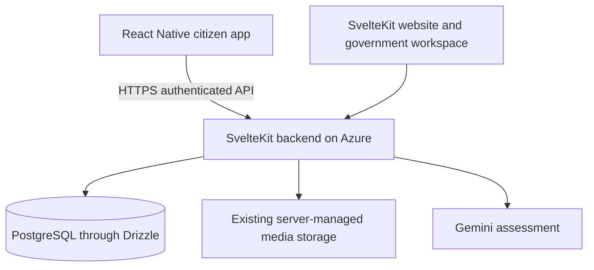
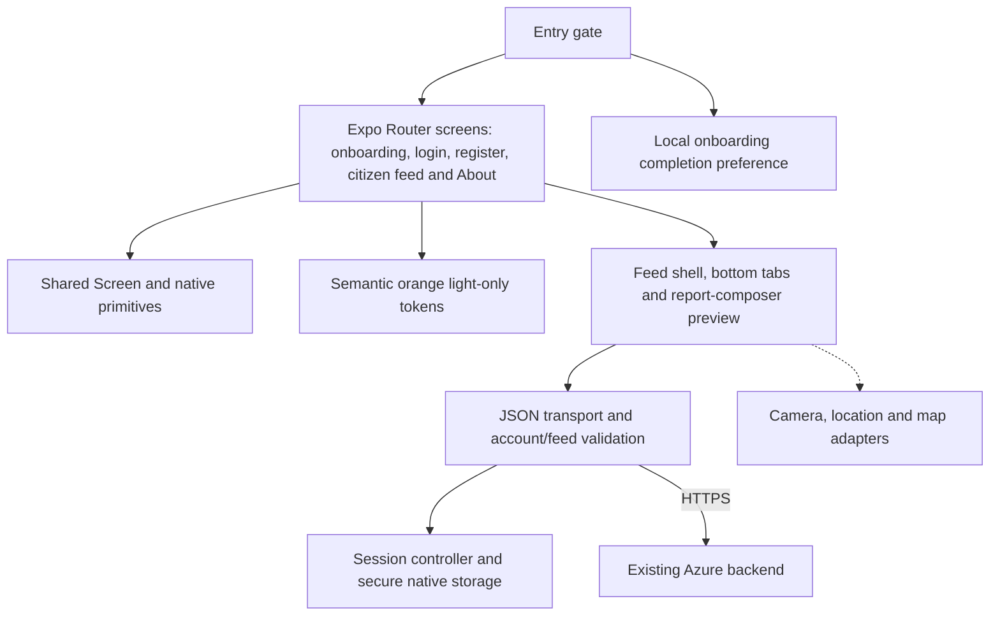
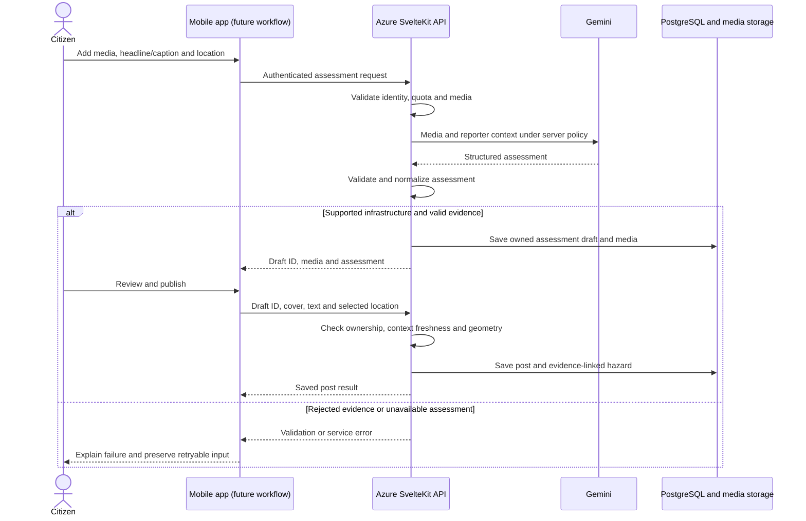

# Mobile system architecture

## Current implementation

The repository is an Expo-managed React Native client with a browser preview. Citizen signup, shared-account sign-in, session restoration/logout and paginated saved feed reads call the existing SuriOS API. Tokens use native SecureStore or browser tab-scoped sessionStorage; passwords and private account records are never persisted. The map, notifications and report composer remain labeled previews. The app keeps its orange light appearance regardless of the system setting. Expo Router owns navigation and protected account routes. There are no direct database connections or Gemini calls from the client.

## Current screens and first-run behavior

The entry route restores a saved session through the server. A verified session opens the citizen area; pending/rejected accounts see their approval status. Otherwise it reads the versioned onboarding preference. The three-card introduction retains Next, progress, Skip and sign-in. Completing/skipping stores the preference and opens registration; returning signed-out installs see sign-in.

The forms validate locally and send JSON credentials to the existing backend. Signup creates a citizen account; other roles sign in with their existing website accounts. Inputs survive errors, repeated submissions are guarded, and a late cancelled response cannot sign someone in. Protected routes no longer offer an unauthenticated preview bypass. Full posts and resolution evidence open on the website; in-app discussions are future work.

## Shared backend architecture

Account/feed requests implement this client/server boundary. The remaining reporting workflow is planned. This repository does not deploy new services; the configured Azure backend must already be running the merged API implementation.

| Layer | Responsibility |
| --- | --- |
| Screens | Navigation, input, accessible feedback, rendering API results |
| Native integrations, future | Camera/gallery permissions, GPS and device-specific behavior |
| Mobile API client | Validated JSON requests, timeouts, errors, origin checks, account/feed parsing and session handling; uploads are future work |
| Azure backend | Authentication, authorization, input validation, assessment, grouping and resolution rules |
| PostgreSQL | Authoritative users, posts, hazards, linked reports and official updates |
| Media storage | Original uploads and government evidence; lifecycle controlled by backend |
| Gemini | Server-invoked analysis under the existing evidence-grounding rules |

## Reporting data flow, planned

1. Citizen authenticates against the existing backend using the implemented bearer session flow.
2. Citizen captures/selects media and identifies the issue location.
3. Mobile sends media and reporter context to authenticated backend assessment endpoints.
4. Backend validates media and permissions, calls Gemini and returns the saved assessment draft.
5. Citizen reviews the result and submits the report. Backend validates the draft and selected geometry and persists the post.
6. Web and mobile read the same saved report. Official progress/resolution updates remain authoritative backend records.
7. Resolving a hazard updates linked posts through existing server rules; mobile displays the official evidence link returned by the API.

Physical severity, community support and response priority remain separate concepts. Mobile must not replace server classification or grouping with client-side guesses. A selected road segment is location context and does not change the assessed infrastructure type.

## Remaining integration work

The existing SvelteKit backend now exposes a documented mobile API alongside website loaders/actions. Mobile account/feed calls use bearer sessions; browser cookies remain separate. Remaining work:

- Run authentication on a physical device. Azure API and browser login/session/feed/logout are verified at `https://surios.site`, with both localhost browser origins allowlisted.
- Add native camera/gallery/location tools and wire the existing assessment/publication contracts.
- Preserve upload limits, draft ownership, cancellation and server-side validation.
- Add in-app threads, social interactions and profile editing; existing links currently open the website.
- Keep backend CORS limited to exact browser-preview origins. Native requests need no synthetic Origin.

No second database, separate seeding process or duplicate Gemini integration is introduced. The public backend origin is configuration; a new Azure IP is unnecessary. Relative media/post URLs already resolve against that origin.

## Security and runtime boundaries

All EXPO_PUBLIC variables are public build configuration. Gemini keys, DB credentials and signing secrets never belong in those variables or source control. Native credentials use SecureStore; browser-preview credentials last for the tab in sessionStorage. Stored tokens are bound to their issuing backend origin, cleared on 401/logout and never decoded as JWTs. Restoring requires server validation; an offline failure keeps the credential and offers retry. The backend owns expiry, rolling renewal and revocation. See [AUTHENTICATION.md](AUTHENTICATION.md) for the full sequence.

Camera/GPS require runtime consent and useful denial handling. Offline drafts, background sync and push notifications are future work, not existing guarantees. The default design requires network access for live reports and assessment.

Browser export verifies a web target. Android bundle export verifies JavaScript bundling. Neither proves native permissions, signing, installation or store acceptance. Those require a device build and explicit testing.

## Application component architecture

The mobile app follows a layered client design. Routes, UI, account/feed API transport and session/storage layers are implemented; device reporting adapters remain future work.

| Component | Current location/status | Responsibility and limit |
| --- | --- | --- |
| Root navigator | `src/app/_layout.tsx` | Session provider, protected stack routes, native header, dark-content status bar and light background |
| Entry route | `src/app/index.tsx` | Restores the server-verified session, then handles onboarding/sign-in routing. |
| Home route | `src/app/home.tsx` | Alias of the citizen feed for predictable home navigation. |
| Citizen route | `src/app/citizen.tsx` | Saved feed and own-account/logout panel; map, notifications and publishing remain previews. |
| Feed | `src/components/citizen/community-feed.tsx` | Virtualized saved original/official posts, photos, cumulative pagination, refresh/retry and website links. |
| Report composer | `src/components/citizen/report-composer.tsx` | In-memory text preview with honest camera/location/publishing-not-connected feedback. |
| Citizen tab bar | `src/components/citizen/citizen-tab-bar.tsx` | Fixed bottom navigation and prominent center report action. |
| Onboarding route | `src/app/onboarding.tsx` | Three slides, Next/Skip/create-account, returning-user sign-in link; stores completion locally. |
| Account form | `src/components/auth/account-form.tsx` | Login/citizen-signup JSON calls, validation, loading, field retention, password visibility and duplicate-submit guard. |
| Session controller/provider | `src/auth/session-controller.ts`, `session-provider.tsx` | Validated session lifecycle, restoration, revocation, stale-response guards and authenticated API requests. |
| Token storage | `src/auth/session-storage.ts`, `.web.ts` | Native SecureStore and browser sessionStorage; origin-bound token record only. |
| About route | `src/app/about.tsx` | Multi-asset scope and SDG 9 context |
| Missing route | `src/app/+not-found.tsx` | Recovery link for unmatched navigation |
| Shared page shell | `src/components/screen.tsx` | Scroll container, safe-area edges and bounded readable width |
| Brand/auth primitives | `src/components/auth/brand-mark.tsx`, `onboarding-art.tsx` | Orange wordmark and native onboarding illustrations. |
| Onboarding preference key | `src/constants/onboarding.ts` | Versioned local AsyncStorage key; no account/session credential storage. |
| Appearance | `src/constants/theme.ts`, `app.json` | Fixed orange light appearance, independent of system theme |
| Public configuration | `src/config/environment.ts` | Reads the public existing website/backend origin; HTTP development only, HTTPS releases. |
| API/data layer | `src/lib/api-client.ts`, `feed.ts`, `src/auth/api.ts` | JSON transport, runtime validation, timeouts and safe error handling. |
| Device adapters | Not implemented | Future camera, location permissions and platform-specific integrations |

Use component-local state for local interactions and the shared React session context for authentication. No external global-state framework or server-state cache is introduced.

## Existing backend integration points

Account/feed integration follows [the backend mobile API contract](https://github.com/Auvryy/surios-ai/blob/main/docs/MOBILE_API.md). The account paths below are wired; other routes are existing backend capabilities for subsequent mobile work. Preserve payloads, role checks, response shapes and origin enforcement.

| Server route | Existing role in the platform | Mobile integration consideration |
| --- | --- | --- |
| `POST /api/auth/login`, `/api/auth/register` | Existing accounts and citizen signup | Implemented JSON calls and validated opaque bearer response |
| `GET /api/auth/session`, `POST /api/auth/logout` | Restore/renew and revoke current session | Implemented session lifecycle and approval handling |
| `GET /api/community/posts` | Loads the community feed | Implemented bearer-personalized feed; cumulative pages replace data rather than append duplicates |
| `POST /api/community/assess` | Accepts media and reporter context, performs assessment and saves a draft | Multipart uploads, request identity, cancellation, quota/errors and draft ownership |
| `POST /api/community/posts` | Publishes from a validated assessment draft | JSON validation, context freshness, cover selection and verified road geometry |
| `/api/community/drafts/[id]` | Draft lifecycle endpoint | Inspect supported methods and cleanup behavior before wiring cancel/discard |
| `/api/map/hazards` | Map hazard data | Inspect filters, permissions, payload size and refresh strategy |
| `/api/roads` | Road-reference data | Verify geometry shape, limits and road selection semantics |
| `/api/community/posts/[id]` | Individual-post operations | Inspect supported methods; do not infer operations from the URL alone |
| `/api/community/reposts` and `/api/community/reposts/[id]` | Reposts and official updates | Preserve update-specific interactions, permissions and resolution linking |
| `/api/profile` | Profile operations | Inspect ownership, upload limits and supported mutations |

Existing website authentication uses its own `surios_session` cookie. Mobile login uses opaque bearer credentials stored by the backend as hashed session identifiers. The transport explicitly omits cookies. Feature APIs enforce account status and roles on the server even though navigation also hides protected screens. SMTP is not required for login/citizen signup; email recovery remains a separate backend capability.

## Planned assessment and publication sequence

The mobile client should cancel/discard through the agreed draft lifecycle rather than merely hide a loading indicator. It must ignore stale responses and cannot reuse an assessment after relevant evidence/context changes unless the backend validates it. Publication success is confirmed only by the backend response; navigation alone is not proof of persistence.

## Shared data model and ownership

These are conceptual platform entities, not a new database schema or migration proposal.

| Entity | Source of truth | Mobile responsibility |
| --- | --- | --- |
| User and session | Existing backend/database | Present allowed identity fields and maintain an agreed session lifecycle |
| Assessment draft | Backend-owned, time-limited draft | Hold a draft reference, show observations and honor validity/cancellation |
| Citizen post and media | Backend records plus media storage | Render actual content and upload through validated endpoints |
| Hazard and linked reports | Backend grouping logic | Display returned grouping/status; never merge nearby reports locally |
| Official update and evidence | Government-authored backend record | Display status, evidence and the linked resolution explanation |
| Reaction, comment and repost | Backend interaction records | Update UI from saved results and recover from rejected mutations |

Several posts can point to the same hazard. Resolving that hazard changes linked post status, while the explanation lives in the official update. Display counts and references from the backend; do not count every progress update as another distinct repaired hazard.

## Deployment and environments

| Runtime | Runs where | Configuration and outputs |
| --- | --- | --- |
| Development bundler | Developer PC, usually port 8081 | Expo serves the mobile JavaScript and browser preview |
| Browser preview | Developer browser | React Native Web; exact backend CORS allowlist and tab-scoped session credential |
| Android/iOS app | Physical phone or emulator | Same configured backend origin, SecureStore and own bearer session; physical execution still needs device verification |
| Web/backend | Existing Azure deployment | SvelteKit service, server secrets and current API/business rules |
| Database/media | Existing server infrastructure | Shared records and uploads; no database credential in the app |
| Native build pipeline | Not configured | Future EAS or local SDK/JDK build; signing and identifiers still pending |

This repository does not provision or redeploy Azure. Installing or updating a mobile app does not apply backend migrations. Any necessary backend changes must be implemented, reviewed and deployed separately, with API compatibility maintained for installed app versions. Changing a bundled API origin requires an appropriate app rebuild/update; it is not a server-side secret switch.

## Architecture decisions and open work

- **Separate mobile client, shared backend:** preserves one authoritative issue lifecycle while allowing a device-focused interface.
- **React Native + Expo:** follows the selected stack and supports a browser/physical-phone workflow without requiring an emulator for daily layout work.
- **Server-side assessment:** protects keys and keeps evidence/severity policy consistent across clients.
- **No speculative second database or backend:** avoids split user accounts, reports and resolution state.
- **Shared opaque sessions:** preserve existing backend accounts/approval/renewal/revocation; native SecureStore and browser sessionStorage replace any assumption of shared website cookies. No second authentication service is introduced.
- **Map implementation remains undecided:** select a native-compatible street-map approach after device and licensing requirements are verified; Leaflet is browser-based and cannot simply be dropped into native views.
- **Release tooling remains unconfigured:** package/bundle identifiers, final artwork, build profiles, signing and device validation are later work.
- **Offline and notifications remain future scope:** no background delivery, synchronization or real-time update guarantee is present.

Use [ROADMAP.md](ROADMAP.md) for implementation order and [DEVELOPMENT.md](DEVELOPMENT.md) for commands and current audit findings.
