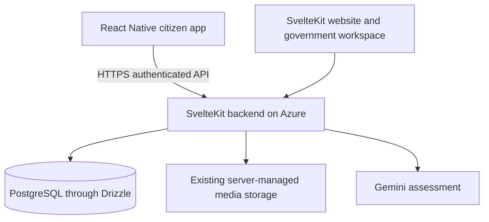
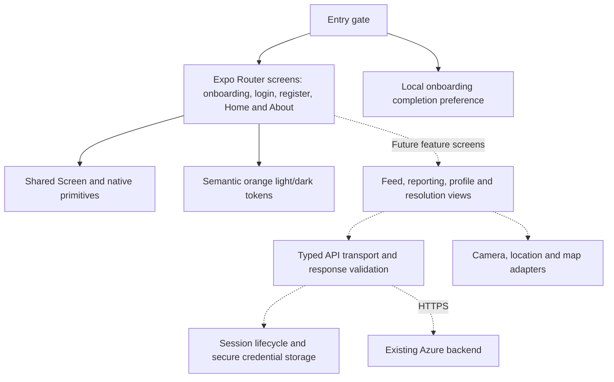
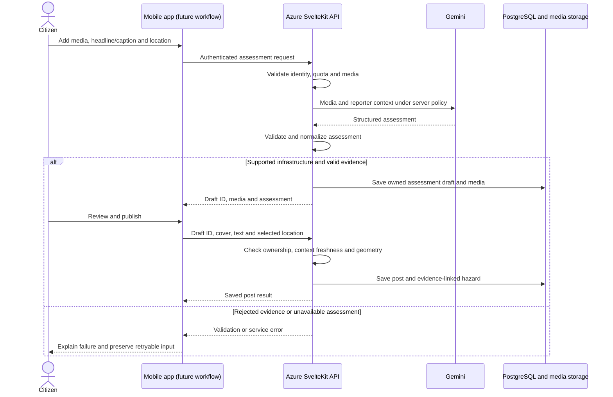

# Mobile system architecture

## Current implementation

The repository is an Expo-managed React Native client with a static browser preview. Home, About, onboarding, registration and sign-in UI run locally; onboarding completion is saved in device storage. Credential forms perform basic client-side validation, show a clear not-connected notice and make no backend requests. No credentials are stored, and there are no database connections or AI calls. Expo Router owns navigation. Shared semantic color tokens support system light/dark mode.

## Current screens and first-run behavior

On a fresh install, the entry route reads a versioned AsyncStorage key and sends the user to onboarding. The introduction has three cards with Next controls, a progress indicator, Skip, and a sign-in route. Completing/skipping stores the preference and opens registration. Returning installs go to the sign-in interface. Users can still switch between sign-in and registration.

The login and registration screens currently validate inputs on-device and then display a message that authentication is unavailable. They do not send, persist or log entered credentials. The forms are interface groundwork only; no account is created.

## Intended integrated architecture

The diagram describes the target integration, not services newly deployed by this repository.

| Layer | Responsibility |
| --- | --- |
| Screens | Navigation, input, accessible feedback, rendering API results |
| Native integrations, future | Camera/gallery permissions, GPS and device-specific behavior |
| Mobile API client, future | Validated requests, upload progress, errors and session handling |
| Azure backend | Authentication, authorization, input validation, assessment, grouping and resolution rules |
| PostgreSQL | Authoritative users, posts, hazards, linked reports and official updates |
| Media storage | Original uploads and government evidence; lifecycle controlled by backend |
| Gemini | Server-invoked analysis under the existing evidence-grounding rules |

## Reporting data flow, planned

1. Citizen authenticates against the backend. Mobile credential/session handling must be designed before live sign-in.
2. Citizen captures/selects media and identifies the issue location.
3. Mobile sends media and reporter context to authenticated backend assessment endpoints.
4. Backend validates media and permissions, calls Gemini and returns the saved assessment draft.
5. Citizen reviews the result and submits the report. Backend validates the draft and selected geometry and persists the post.
6. Web and mobile read the same saved report. Official progress/resolution updates remain authoritative backend records.
7. Resolving a hazard updates linked posts through existing server rules; mobile displays the official evidence link returned by the API.

Physical severity, community support and response priority remain separate concepts. Mobile must not replace server classification or grouping with client-side guesses. A selected road segment is location context and does not change the assessed infrastructure type.

## Integration work required

The existing SvelteKit website uses server-rendered loaders/actions and sessions. A native client cannot reuse Svelte page components or assume browser cookies work unchanged. Before connecting screens:

- Audit existing endpoints and expose suitable authenticated JSON contracts where needed.
- Choose a mobile session flow and secure credential storage; retain logout/revocation and role permissions.
- Define browser-preview CORS, cookie/CSRF behavior and trusted origins explicitly.
- Resolve relative media and post URLs against the configured backend origin.
- Preserve upload limits, draft ownership, error handling, pagination and server-side validation.
- Test account and media access using the same Azure environment as the website.

No second database, separate seeding process or duplicate Gemini integration is planned. No API domain has been assumed.

## Security and runtime boundaries

All EXPO_PUBLIC variables are public build configuration. Gemini keys, DB credentials and signing secrets never belong in those variables or source control. Future persisted mobile credentials should use platform-secure storage. A shared backend does not imply sharing a browser session automatically.

Camera/GPS require runtime consent and useful denial handling. Offline drafts, background sync and push notifications are future work, not existing guarantees. The default design requires network access for live reports and assessment.

Browser export verifies a web target. Android bundle export verifies JavaScript bundling. Neither proves native permissions, signing, installation or store acceptance. Those require a device build and explicit testing.

## Application component architecture

The mobile app follows a layered client design. The first three boxes below are implemented; the API, session and native-adapter layers are integration work.

| Component | Current location/status | Responsibility and limit |
| --- | --- | --- |
| Root navigator | `src/app/_layout.tsx` | Stack routing, native header, status bar and theme-aware page background |
| Entry route | `src/app/index.tsx` | Reads local onboarding completion and redirects first-time/returning users. |
| Home route | `src/app/home.tsx` | Retained product introduction and local starter overview. |
| Onboarding route | `src/app/onboarding.tsx` | Three slides, Next/Skip/create-account, returning-user sign-in link; stores completion locally. |
| Account form | `src/components/auth/account-form.tsx` | Login/register fields, visibility controls and local validation; announces that server auth is not connected. |
| About route | `src/app/about.tsx` | Multi-asset scope and SDG 9 context |
| Missing route | `src/app/+not-found.tsx` | Recovery link for unmatched navigation |
| Shared page shell | `src/components/screen.tsx` | Scroll container, safe-area edges and bounded readable width |
| Brand/auth primitives | `src/components/auth/brand-mark.tsx`, `onboarding-art.tsx` | Orange wordmark and native onboarding illustrations. |
| Onboarding preference key | `src/constants/onboarding.ts` | Versioned local AsyncStorage key; no account/session credential storage. |
| Appearance | `src/constants/theme.ts` | System light/dark selection and semantic orange colors |
| Public configuration | `src/config/environment.ts` | Reads an optional public backend origin; performs no network requests |
| API/session/data layer | Not implemented | Future requests, response validation, loading/error state and authenticated access |
| Device adapters | Not implemented | Future camera, location permissions and platform-specific integrations |

Use component-local state for local interactions. A future server-state cache should be introduced only when fetching/mutation requirements justify it; no cache, global state library or persistence adapter is configured now.

## Existing backend integration points

The following paths were checked in the web repository during this documentation update. They are existing server routes, **not implemented mobile calls or a frozen mobile API contract**. Read their source again before integration, including accepted payloads, role checks, response shapes and origin enforcement.

| Server route | Existing role in the platform | Mobile integration consideration |
| --- | --- | --- |
| `GET /api/community/posts` | Loads the community feed | Pagination/filter contracts and public versus authenticated fields |
| `POST /api/community/assess` | Accepts media and reporter context, performs assessment and saves a draft | Multipart uploads, request identity, cancellation, quota/errors and draft ownership |
| `POST /api/community/posts` | Publishes from a validated assessment draft | JSON validation, context freshness, cover selection and verified road geometry |
| `/api/community/drafts/[id]` | Draft lifecycle endpoint | Inspect supported methods and cleanup behavior before wiring cancel/discard |
| `/api/map/hazards` | Map hazard data | Inspect filters, permissions, payload size and refresh strategy |
| `/api/roads` | Road-reference data | Verify geometry shape, limits and road selection semantics |
| `/api/community/posts/[id]` | Individual-post operations | Inspect supported methods; do not infer operations from the URL alone |
| `/api/community/reposts` and `/api/community/reposts/[id]` | Reposts and official updates | Preserve update-specific interactions, permissions and resolution linking |
| `/api/profile` | Profile operations | Inspect ownership, upload limits and supported mutations |

Existing web authentication uses a `surios_session` cookie. There is no mobile login implementation here. A native authentication design must be established before assuming any authenticated route is callable. Listing a path above does not promise native compatibility.

## Planned assessment and publication sequence

The mobile client should cancel/discard through the agreed draft lifecycle rather than merely hide a loading indicator. It must ignore stale responses and cannot reuse an assessment after relevant evidence/context changes unless the backend validates it. Publication success is confirmed only by the backend response; navigation alone is not proof of persistence.

## Shared data model and ownership

These are conceptual platform entities, not a new database schema or migration proposal.

| Entity | Source of truth | Mobile responsibility |
| --- | --- | --- |
| User and session | Existing backend/database | Present allowed identity fields and maintain an agreed session lifecycle |
| Assessment draft | Backend-owned, time-limited draft | Hold a draft reference, show observations and honor validity/cancellation |
| Citizen post and media | Backend records plus media storage | Render actual content and upload through validated endpoints |
| Hazard and linked reports | Backend grouping logic | Display returned grouping/status; never merge nearby reports locally |
| Official update and evidence | Government-authored backend record | Display status, evidence and the linked resolution explanation |
| Reaction, comment and repost | Backend interaction records | Update UI from saved results and recover from rejected mutations |

Several posts can point to the same hazard. Resolving that hazard changes linked post status, while the explanation lives in the official update. Display counts and references from the backend; do not count every progress update as another distinct repaired hazard.

## Deployment and environments

| Runtime | Runs where | Configuration and outputs |
| --- | --- | --- |
| Development bundler | Developer PC, usually port 8081 | Expo serves the mobile JavaScript and browser preview |
| Browser preview | Developer browser | React Native Web; API-origin/CORS work is still pending |
| Android/iOS app | Physical phone or emulator | Future native build; same configured backend origin, own mobile session |
| Web/backend | Existing Azure deployment | SvelteKit service, server secrets and current API/business rules |
| Database/media | Existing server infrastructure | Shared records and uploads; no database credential in the app |
| Native build pipeline | Not configured | Future EAS or local SDK/JDK build; signing and identifiers still pending |

This repository does not provision or redeploy Azure. Installing or updating a mobile app does not apply backend migrations. Any necessary backend changes must be implemented, reviewed and deployed separately, with API compatibility maintained for installed app versions. Changing a bundled API origin requires an appropriate app rebuild/update; it is not a server-side secret switch.

## Architecture decisions and open work

- **Separate mobile client, shared backend:** preserves one authoritative issue lifecycle while allowing a device-focused interface.
- **React Native + Expo:** follows the selected stack and supports a browser/physical-phone workflow without requiring an emulator for daily layout work.
- **Server-side assessment:** protects keys and keeps evidence/severity policy consistent across clients.
- **No speculative second database or backend:** avoids split user accounts, reports and resolution state.
- **Authentication remains undecided:** choose and validate native session transport, secure storage, expiry/revocation and browser-preview behavior in the first integration phase.
- **Map implementation remains undecided:** select a native-compatible street-map approach after device and licensing requirements are verified; Leaflet is browser-based and cannot simply be dropped into native views.
- **Release tooling remains unconfigured:** package/bundle identifiers, final artwork, build profiles, signing and device validation are later work.
- **Offline and notifications remain future scope:** no background delivery, synchronization or real-time update guarantee is present.

Use [ROADMAP.md](ROADMAP.md) for implementation order and [DEVELOPMENT.md](DEVELOPMENT.md) for commands and current audit findings.
